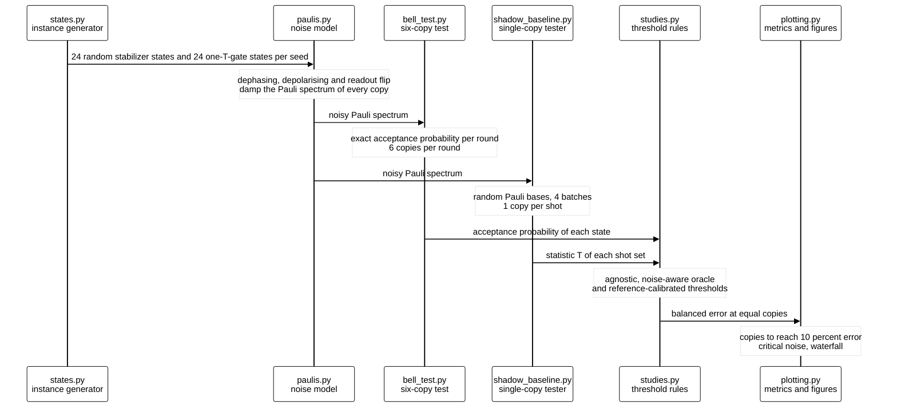
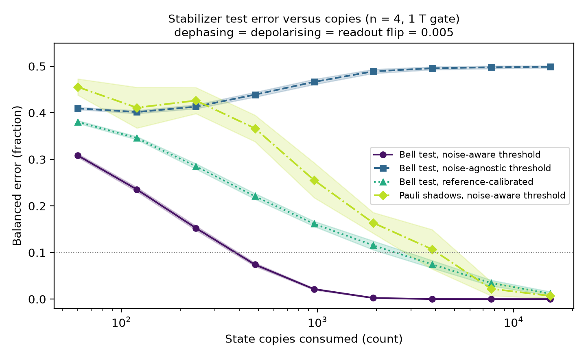
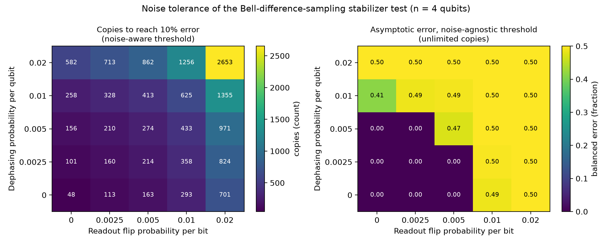
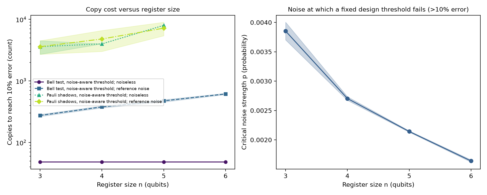
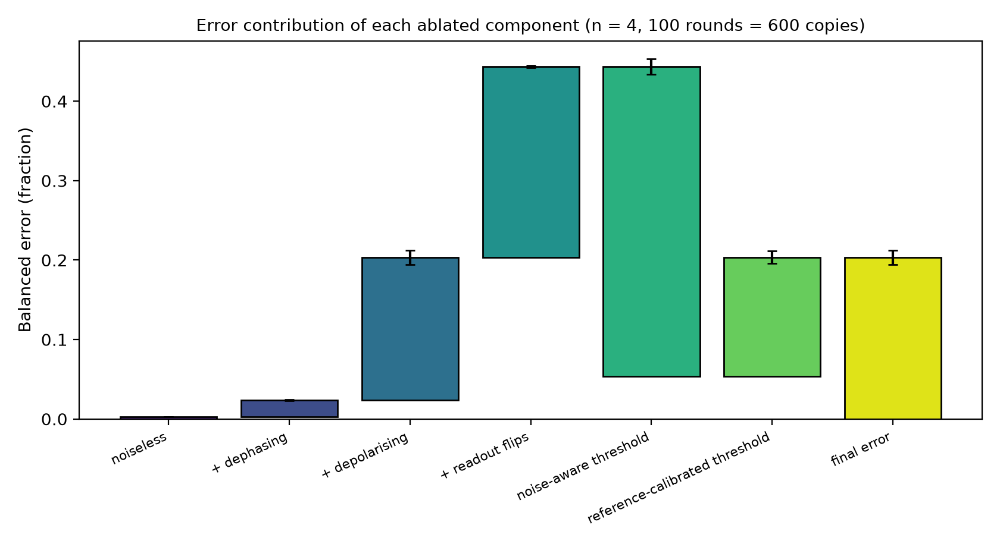

# Copy Cost of Bell-Difference-Sampling Stabilizer Testing Under Dephasing, Depolarising and Readout Noise

[](LICENSE)
[](pyproject.toml)
[](https://github.com/pradeepdegalaroyal/bell-difference-stabilizer-test-noise-copy-cost/actions/workflows/ci.yml)

**Research question.** How many noisy copies of an n-qubit state does the six-copy Bell-difference-sampling test need to
tell a stabilizer state from a state with one T gate, when the textbook acceptance threshold is no longer valid because
of dephasing, depolarising and readout noise?

**Short answer (exact simulation, n = 3 to 6).** A threshold fixed from noiseless design values fails (more than 10%
balanced error even with unlimited copies) at a noise strength of only 0.00385 ± 0.00015 for n = 3, falling to
0.00164 ± 0.00002 for n = 6; a noise-aware threshold needs 378.0 ± 14.1 copies at n = 4 with 0.005 noise per source, about
13 times fewer than a single-copy Pauli-shadow tester; a label-free reference calibration works but costs roughly four
times the error of the oracle at the same budget.

**Abstract.** Property testing of quantum states is usually analysed with ideal gates and a constant copy count. This
study computes the exact acceptance statistics of the Bell-difference-sampling stabilizer test under local dephasing,
depolarising and readout noise, and measures the copies needed to reach 10% balanced error for three decision
thresholds (noise-agnostic, noise-aware, reference-calibrated) against a classical-shadow baseline on 3 to 6 qubits.
All results are classical simulation of small registers; no quantum advantage is claimed.

## Motivation

Spin-defect registers are limited by dephasing and imperfect readout (Wolfowicz et al., 2021, DOI
10.1038/s41578-021-00306-y), and learning with data that must stay on the client raises the question of what a
participant can verify about its own quantum data with few copies (Umair et al., 2027, DOI
10.1016/j.bspc.2026.111685). Deciding "stabilizer state or not" is a minimal property-testing problem in this setting:
the ideal test uses a constant number of copies, but every real copy is noisy, and a noisy stabilizer state is no
longer accepted with probability one. The noise therefore moves the decision threshold, not only the variance.

## Research gap

The two papers supplied for this project (one review, one adjacent study) describe the noise of spin-defect registers
and the privacy motivation for local, copy-limited verification, but neither quantifies the copy cost of a quantum
property test under that noise. See `docs/RESEARCH_GAP.md` for the related-work table, the hypotheses and the note that
the provided literature contained only two papers.

### Hypotheses

* **H1.** A noise-agnostic threshold has a critical noise p\_crit that decreases with n. **Supported** (Table 3).
* **H2.** With a noise-aware threshold the Bell test needs fewer copies than the shadow tester for n = 3 to 5. **Supported**
  in this simulation (Table 2), with caveats on resource parity below.
* **H3.** A reference-calibrated threshold has less than half of the noise-agnostic error at equal total copies.
  **Weakly supported**: at 600 copies its error is 0.204 against 0.444 for the agnostic threshold, but it stays about
  four times above the oracle error of 0.054 (Table 4).

## What is new here

* Exact (not sampled) acceptance probabilities of the noisy six-copy test, validated against a direct Bell-basis
  computation, including readout flips on the parity that enters the decision.
* A critical-noise scaling of the fixed design threshold with register size.
* A waterfall ablation that separates the cost of each noise source from the cost of repairing the threshold, including
  the price of calibrating on a reference instead of using an oracle.
* A same-copies comparison with a single-copy classical-shadow tester under the same noise.

## Method



Legend: Pauli spectrum = list of all 4^n Pauli expectation values of a state; "one-T-gate state" = random Clifford,
one T gate, random Clifford, applied to the all-zero state. Full definitions are in `docs/METHOD.md`.

Summary. Null instances are Haar-random stabilizer states; alternatives are random Clifford circuits with one T gate
(stabilizer 2-Rényi entropy 0.415 bit, noiseless acceptance 0.812). The Bell test accepts a round with exact probability
computed from the noisy Pauli spectrum; the shadow tester estimates the fourth-moment statistic from single-copy random
Pauli measurements. Three thresholds are compared: noise-agnostic (noiseless design value), noise-aware (oracle best
fixed threshold, an upper bound) and reference-calibrated (half of the copies spent on a noisy stabilizer reference).

## Results

All numbers are mean ± standard deviation over 5 seeds (24 + 24 states per seed) and come from `results/`
(`summary.json` collects them). Reference noise: dephasing = depolarising = readout flip = 0.005, n = 4.



*Figure 1. At a noise of 0.005 per source the noise-agnostic threshold converges to chance (0.5) while the noise-aware
Bell test crosses 10% error near 380 copies.*

**Table 1. Balanced error versus copies (n = 4, `results/curves.csv`).**

| Copies | Bell, noise-aware | Bell, noise-agnostic | Bell, reference-calibrated | Pauli shadows, noise-aware |
|---|---|---|---|---|
| 480 | 0.074 ± 0.004 | 0.439 ± 0.005 | 0.221 ± 0.006 | 0.367 ± 0.028 |
| 960 | 0.021 ± 0.002 | 0.466 ± 0.006 | 0.162 ± 0.006 | 0.256 ± 0.038 |
| 3840 | 0.000 ± 0.000 | 0.496 ± 0.003 | 0.075 ± 0.008 | 0.107 ± 0.042 |
| 15360 | 0.000 ± 0.000 | 0.499 ± 0.002 | 0.012 ± 0.004 | 0.007 ± 0.005 |



*Figure 2. Noise raises the copy cost smoothly for a noise-aware threshold (left) but a fixed threshold fails abruptly,
at 0.01 readout flips even with no dephasing (right).*



*Figure 3. The Bell test's copy cost grows slowly with n while the critical noise of a fixed threshold shrinks
roughly as 1/n.*

**Table 2. Copies to reach 10% balanced error (`results/scaling.csv`).**

| n | Bell, noiseless | Bell, noise 0.005 | Shadows, noiseless | Shadows, noise 0.005 | Shadows / Bell at noise 0.005 |
|---|---|---|---|---|---|
| 3 | 48.0 ± 0.0 | 274.8 ± 10.7 | 3600 ± 894 | 3600 ± 894 | 13.2 ± 3.4 |
| 4 | 48.0 ± 0.0 | 378.0 ± 14.1 | 4000 ± 0 | 4800 ± 1789 | 12.7 ± 4.9 |
| 5 | 48.0 ± 0.0 | 474.0 ± 20.3 | 8000 ± 0 | 7200 ± 1789 | 15.3 ± 4.0 |
| 6 | 48.0 ± 0.0 | 614.4 ± 15.1 | not run | not run | not run |

**Table 3. Critical noise of the noise-agnostic threshold (`results/critical_noise.csv`).**

| n | p\_crit (probability) |
|---|---|
| 3 | 0.00385 ± 0.00015 |
| 4 | 0.00270 ± 0.00003 |
| 5 | 0.00214 ± 0.00001 |
| 6 | 0.00164 ± 0.00002 |



*Figure 4. At 600 copies the noise sources raise the error from 0.003 to 0.444 under a fixed threshold; an oracle
threshold removes 0.390 of it, and a label-free reference calibration adds 0.150 of error back.*

**Table 4. Waterfall ablation at 600 copies, n = 4 (`results/waterfall.csv`).**

| Step | Balanced error after step | Change |
|---|---|---|
| noiseless | 0.003 ± 0.000 | |
| + dephasing | 0.024 ± 0.001 | +0.021 ± 0.001 |
| + depolarising | 0.203 ± 0.010 | +0.180 ± 0.009 |
| + readout flips (agnostic threshold) | 0.444 ± 0.010 | +0.240 ± 0.002 |
| noise-aware threshold | 0.054 ± 0.002 | −0.390 ± 0.010 |
| reference-calibrated threshold | 0.204 ± 0.009 | +0.150 ± 0.008 |

Heatmap cells quoted from `results/heatmap.csv`: 48.0 copies with no noise; 273.6 ± 11.7 at dephasing = readout = 0.005;
2653.2 ± 161.6 at dephasing = readout = 0.02.

## Discussion

The central finding is that noise moves the *level* of the acceptance statistic by far more than it shrinks the
*gap* between the classes. With a noise-aware threshold the copy cost grows only from 48 (noiseless) to 378.0 ± 14.1 at
n = 4, but a threshold taken from noiseless design values breaks at p\_crit = 0.00270 ± 0.00003, so the failure is a
calibration failure rather than a statistical-power failure. Dephasing alone is cheap in this test (+0.021 error at
600 copies); depolarising noise and readout flips, which affect every Pauli weight, dominate the loss.

Negative and cautionary results:

* The noise-aware threshold is an **oracle**: it is chosen using the labelled ensembles. The deployable alternative, a
  label-free reference calibration, leaves 0.204 ± 0.009 error at 600 copies against 0.054 ± 0.002 for the oracle, and
  reaches 10% error only between 1920 and 3840 copies (errors 0.116 and 0.075 in Table 1) against 378.0 ± 14.1 for the
  oracle. Hypothesis H3 therefore holds only in its weak form.
* The noise-agnostic threshold is useless beyond p of about 0.0027 for n = 4 and does not improve with more copies.
* The reference is itself a random stabilizer state whose noisy acceptance depends on the Pauli weights of its
  stabilizer group; state-to-state spread of the null acceptance is what limits the calibrated rule.
* The shadow comparison is in *copies*, not in resources. The Bell test needs an entangling Bell measurement between
  copies, whose gate errors are not modelled (only readout flips are); shadows use single-qubit gates on single copies.
  The 13-fold advantage in copies at p = 0.005 therefore should not be read as an advantage on hardware.
* Shadow copy counts come from a grid with factor-two resolution and Monte Carlo error from 6 trials on 12 states per
  class; the shadow threshold is chosen in-sample, which favours the baseline.

## Limitations

* Exact classical simulation of 3 to 6 qubits; noise is independent, identical on every copy and applied after state
  preparation. Correlated noise, drift between copies and non-stationary calibration are not modelled.
* No gate noise in the Bell-measurement circuit; readout flips on the measured bits stand in for all measurement-side
  error.
* One alternative class (one T gate, stabilizer 2-Rényi entropy 0.415 bit); no sweep over the distance from the
  stabilizer set, so no statement on the dependence on the far-ness parameter.
* The shadow baseline uses random Pauli measurements only; Clifford-based shadows or other single-copy testers are not
  compared. Pauli-shadow cost is exponential in n for this statistic, so the gap widens with n by construction.
* The provided literature contained only two papers; the related-work analysis is correspondingly thin.

## Future work

* Replace readout flips by a gate-level noise model for the Bell measurement circuit (controlled-NOT (CNOT) and Hadamard errors, then
  transpilation depth and connectivity), and validate the exact formulas against a density-matrix simulator.
* Sweep the alternative's distance from the stabilizer set and prove or fit the dependence of copy cost on it; derive
  an analytic p\_crit that scales as 1/n from the weight distribution of a typical stabilizer group.
* Run the six-copy test on a small spin-defect or trapped-ion register with a reference state prepared on the same
  device to test whether a reference-calibrated threshold is stable in time.
* Federated setting: clients exchange only accepted-round counts and reference counts, and a server pools them; study
  the cost of heterogeneous client noise.

## Reproducibility

```bash
pip install -r requirements.txt && pip install -e .
python experiments/run_all.py --quick   # smoke run, about 20 s, writes results_quick/ and figures_quick/
python experiments/run_all.py           # full run, 749 s, writes results/ and figures/
pytest -q                               # 10 tests
```

The full run took 749.0 s (`results/run_info.json`) on Windows 11, Python 3.11.9, central processing unit only (the
graphics processor is unused), while the machine was also used for other work. Everything is seeded (seeds 0 to 4);
`results/summary.json` collects every number quoted above.

## Project structure

```
src/stabtest/paulis.py            Pauli spectrum, Walsh-Hadamard transform, local noise
src/stabtest/states.py            random stabilizer and one-T-gate instances, stabilizer 2-Renyi entropy
src/stabtest/bell_test.py         exact Bell-difference-sampling statistics, thresholds, copy cost
src/stabtest/shadow_baseline.py   single-copy random-Pauli shadow tester
src/stabtest/studies.py           the four studies (curves, heatmap, scaling, waterfall)
src/stabtest/plotting.py          figures (viridis, 200 dpi)
src/stabtest/summary.py           results/summary.json
experiments/run_all.py            one-command reproduction
tests/                            correctness tests (Bell law against direct simulation, etc.)
docs/                             RESEARCH_GAP.md, METHOD.md
results/  figures/                raw tables and figures
```

## Related work by the author

* [anytime-valid-shot-stopping-quantum-circuit-tests](https://github.com/pradeepdegalaroyal/anytime-valid-shot-stopping-quantum-circuit-tests):
  when a shot-based quantum circuit test may stop, with sequential tests under noise.
* [shot-budget-nystrom-quantum-kernel-noise-floor](https://github.com/pradeepdegalaroyal/shot-budget-nystrom-quantum-kernel-noise-floor):
  a noise floor and shot accounting for a quantum kernel method.

## Licence

Released under the Massachusetts Institute of Technology (MIT) licence; see `LICENSE`.

## Citation

```bibtex
@software{degala2026bellstabilizer,
  author  = {Degala, Chenchupradeep},
  title   = {Copy Cost of Bell-Difference-Sampling Stabilizer Testing Under Dephasing, Depolarising and Readout Noise},
  year    = {2026},
  version = {0.1.0},
  url     = {https://github.com/pradeepdegalaroyal/bell-difference-stabilizer-test-noise-copy-cost},
  license = {MIT}
}
```

MIT license (`LICENSE`). Machine-readable citation metadata: `CITATION.cff`.
